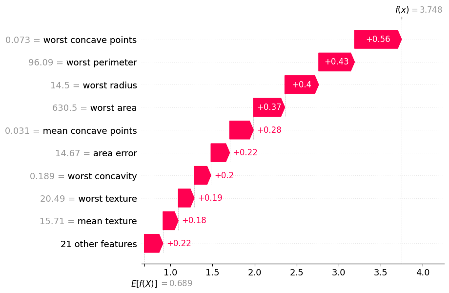
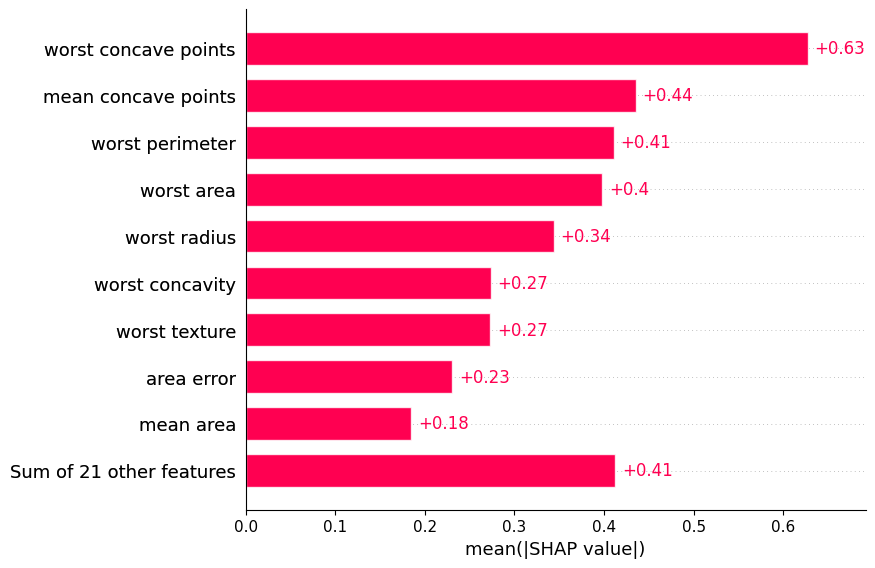

# Evaluating Feature Importance with SHAP Values 

This repository contains a model interpretability exercise that trains an XGBoost classifier on the Breast Cancer Wisconsin dataset and uses SHAP (Shapley Additive Explanations) values to explain its predictions. The focus is on understanding *why* the model makes its decisions and which cell features matter most for feature selection.

---

## Project Overview 🩺

The Breast Cancer Wisconsin (Diagnostic) dataset, included in scikit-learn, contains measurements of cell nuclei taken from digitized images of breast tissue samples.

- 🔬**Features:** 30 numeric measurements: 10 cell characteristics (radius, texture, perimeter, area, smoothness, compactness, concavity, concave points, symmetry, fractal dimension), each reported as a mean, a standard error, and a "worst" (largest) value
- 🎯**Target:** Diagnosis: Malignant (0) or Benign (1)
- 📊**Records:** 569 samples (212 malignant, 357 benign)

An XGBoost classifier (10 trees, max depth 3) was trained on all 30 features. SHAP values were then calculated against a 100-record background sample to measure how much each feature contributed to each prediction.

**What SHAP values measure:** Shapley values come from cooperative game theory. They split a prediction fairly among the features that produced it. Each feature's SHAP value shows how far, and in which direction, it moved the prediction away from the model's average output.

---

## Key Findings 🔎

- **Worst concave points is the most important feature** (mean |SHAP| = 0.63). This is the number of concave portions on the tumor contour, measured on the most irregular cells.
- **Shape and size dominate:** The top features describe how irregular the cell boundary is (concave points, concavity) and how large the cells are (perimeter, area, radius).
- **"Worst" values matter more than averages:** 6 of the top 10 features are "worst" measurements. The most abnormal cells in a sample are more informative than the typical cell.
- **Importance is concentrated:** The top 5 features account for about **62%** of total SHAP importance, and the top 10 account for about **94%**. The other 20 features contribute very little.

| Rank | Feature # | Feature Name | Mean \|SHAP\| |
|---|---|---|---|
| 1 | 27 | worst concave points | 0.628 |
| 2 | 7 | mean concave points | 0.435 |
| 3 | 22 | worst perimeter | 0.411 |
| 4 | 23 | worst area | 0.398 |
| 5 | 20 | worst radius | 0.344 |
| 6 | 26 | worst concavity | 0.274 |
| 7 | 21 | worst texture | 0.273 |
| 8 | 13 | area error | 0.231 |
| 9 | 3 | mean area | 0.185 |
| 10 | 1 | mean texture | 0.185 |

---

## Models and Performance 🔬

### Local Explanation: One Prediction (Waterfall Plot)

The waterfall plot explains the model's prediction for a single sample (index 20, a benign tumor).

- **Starting point:** E[f(X)] = 0.689, the model's average output (in log-odds) across the background sample
- **Final prediction:** f(x) = 3.748, which converts to about a **98% probability of benign**
- **Every feature pushed toward benign.** This sample had a low worst concave points value (0.073), which contributed the most (+0.56). It was followed by worst perimeter (+0.43), worst radius (+0.40), and worst area (+0.37), all reflecting smaller cells.

### Global Explanation: All Predictions (Bar Plot)

The bar plot averages the absolute SHAP values across all 569 samples to rank features by overall influence.

---

## Key Takeaways 💡

**1. SHAP explains individual predictions, not just the model overall.**
Built-in feature importance tells you which features the model uses most. SHAP also explains *why one specific patient* received their prediction. That matters in healthcare, where a model's reasoning needs to be reviewable case by case.

**2. SHAP values have direction as well as size.**
A positive SHAP value pushes toward benign (class 1), and a negative value pushes toward malignant (class 0). The bar plot uses absolute values, which shows how much a feature matters but not which way it pushes.

**3. Local and global importance can differ.**
For sample 20, worst perimeter ranked second. Across all samples, mean concave points ranked second. A feature that is important on average may matter less for a given patient, and the reverse.

**4. Correlated features share credit.**
Worst perimeter, worst area, and worst radius all measure cell size and are almost perfectly correlated (r > 0.97). SHAP divides importance among them, so each one looks less important than "size" really is. For feature selection, keeping one representative from each correlated group is usually enough.

**5. Feature selection opportunity.**
Because about 94% of the importance sits in 10 features, a simpler model trained on a smaller subset would likely perform almost as well. It would also be easier to explain and cheaper to collect data for.

---

## Repository Contents 📁

| File | Description |
|---|---|
| `Exercise-Use_Shapley_Values_for_Feature_Selection.ipynb` | Jupyter notebook with model training, SHAP calculations, and plots |
| `shap-waterfall.png` | Waterfall plot explaining a single prediction (sample 20) |
| `shap-bar-importance.png` | Bar plot of global feature importance (mean \|SHAP\|) |
| `shap-importance-table.png` | Top 10 features ranked by SHAP importance |
| `README.md` | Project documentation |

---

## Model Evolution 🧬

1. **Model selection:** Corrected the starter code from `XGBRegressor` to `XGBClassifier`, since the target is a binary category, not a continuous value
2. **Training:** Fit an XGBoost classifier on all 30 features
3. **Local explanation:** Generated a SHAP waterfall plot for a single prediction
4. **Global explanation:** Calculated mean absolute SHAP values and visualized the top 10 features
5. **Interpretation:** Mapped feature indices to names and analyzed results for feature selection

---

## Future Work 🔭

- Train on a train/test split and report accuracy, precision, recall, and ROC-AUC on held-out data
- Retrain using only the top 5 or top 10 SHAP features and compare performance to the full model
- Group highly correlated features (radius, perimeter, area) before selection to reduce redundancy
- Add a SHAP beeswarm plot to show the direction of each feature's effect across all samples
- Prioritize recall for malignant cases, since a missed malignancy (false negative) costs far more than a false alarm

---

## Contact Information ✉️

For inquiries about this analysis:

- [LinkedIn Profile](https://www.linkedin.com/in/melissaslawsky/)
- [Client Results](https://melissaslawsky.com/portfolio/)
- [Tableau Portfolio](https://public.tableau.com/app/profile/melissa.slawsky1925/vizzes)
- [Email](mailto:melissa@melissaslawsky.com)

---

## Disclaimer 📝

This project was completed as part of the [Udacity Data Science Nanodegree](https://www.udacity.com/course/data-scientist-nanodegree--nd025) program. The Breast Cancer Wisconsin dataset is publicly available through scikit-learn, and the exercise structure was provided by Udacity. All analysis, interpretation, and documentation are my own. This model is for educational purposes only and is not intended for medical diagnosis.

---

© Melissa Slawsky 2026. All Rights Reserved.
